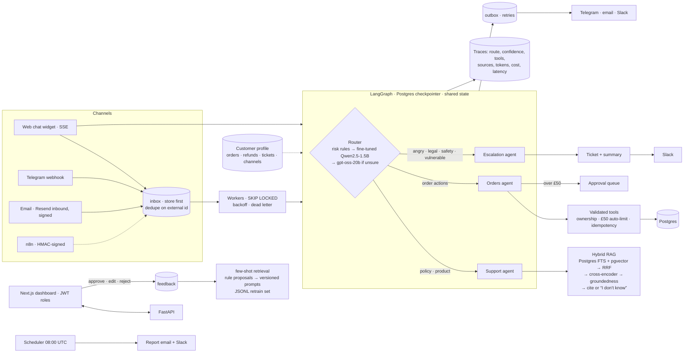

# Keel — the AI operations desk for UK online shops

**One AI system that runs customer operations on its own: it answers customers with cited sources, takes real actions on orders, hands risky cases to humans, learns from corrections and reports to management every morning.**

Demo tenant: **Hearth & Field**, a UK homeware retailer (prices in £, Royal Mail/DPD/Evri, Consumer Rights Act 2015 returns, UK GDPR).

| | |
|---|---|
| Live demo | _added after deployment_ |
| Customer chat (public) | `<live>/chat` |
| Dashboard | `<live>` · admin `admin@keel.demo` / `KeelAdmin!2026` · agent `agent@keel.demo` / `KeelAgent!2026` (test accounts) |
| Demo video | _link_ |
| Requirements checklist | [docs/REQUIREMENTS.md](docs/REQUIREMENTS.md) |
| Write-up | [docs/WRITEUP.md](docs/WRITEUP.md) |

## Architecture



## Features → requirements

| Brief | How Keel does it | Code |
|---|---|---|
| Router + 3 specialists | LangGraph graph; Router = hard risk rules, then the fine-tuned classifier, then an LLM fallback when its confidence is low | `backend/keel/agents.py`, `router.py` |
| Shared memory | Postgres checkpointer per thread + customer profile (orders, refunds, tickets, channels, sentiment) loaded for every agent; Telegram ↔ email linking by email address | `memory.py` |
| Real tool calls | 6 Pydantic-validated functions on SQL; write tools only exposed when the customer asked for that action | `tools.py` |
| Escalation | Anger, legal, chargeback, safety, vulnerability and repeat-complainant signals → ticket + summary + Slack | `agents.py` |
| RAG (≥20 docs) | 10 PDFs, 13 crawled help-centre pages, 168-product CSV → 24 docs / 308 chunks | `corpus/`, `rag/ingest.py` |
| Hybrid + rerank | Postgres full-text + pgvector (bge-small) → Reciprocal Rank Fusion → cross-encoder (MiniLM) | `rag/retrieve.py` |
| Citations / "I don't know" | Sentence-level citations; ungrounded sentences dropped; refuses when nothing is grounded | `rag/answer.py` |
| Fine-tuning | Qwen2.5-1.5B QLoRA (Unsloth, Colab T4) on Bitext + UK synthetic intents; base vs tuned vs 70B | `finetune/` |
| Self-improving loop | Edits/rejections → feedback (with embedding) → few-shot retrieval, exact-match reuse, admin-approved prompt rules, JSONL export | `feedback.py` |
| ≥2 channels | Web chat (SSE), Telegram webhook, email (Resend inbound + outbound) | `main.py` |
| Daily report | APScheduler 08:00 UTC → HTML email + Slack (n8n version included) | `reports.py`, `automation/n8n/` |
| Slack alerts | Escalations + system errors, de-duplicated, rate-limited via outbox | `notify.py` |
| Nothing lost | Store-first inbox/outbox, exponential backoff, dead letter with retry button, idempotency keys, provider fallback Groq → Gemini → rules | `queue.py`, `llm.py` |
| Dashboard | Login with roles (enforced in API), live inbox, streaming, trace timeline, approvals, escalations, customers, analytics, knowledge, feedback & prompts, evals, ops, settings | `frontend/` |
| Evals | 100 cases, `make eval`, per-category scores, Markdown + JSON reports, history on dashboard, CI subset | `evals/` |
| Cost & latency | Tokens, $ cost and latency per request in `traces` | `pipeline.py` |
| Deployment | Dockerfiles + compose; secrets only in env; gitleaks in CI and pre-commit | `docker-compose.yml`, `.github/` |

## Quick start (local)

Requires Docker. LLM keys are optional: without them Keel runs on deterministic rules.

```bash
cp .env.example .env
```

```bash
make up
```

Open http://localhost:3000 (dashboard) and http://localhost:3000/chat (customer chat). The first start seeds data and indexes the documents (~30 s).

**Developer setup** (hot reload):

```bash
uv venv --python 3.12 .venv && uv pip install --python .venv -e "./backend[dev,local]"
```

```bash
docker run -d --name keel-pg -e POSTGRES_USER=keel -e POSTGRES_PASSWORD=keel -e POSTGRES_DB=keel -p 5433:5432 pgvector/pgvector:pg16
```

```bash
cd backend && ../.venv/bin/uvicorn keel.main:app --reload --port 8100
```

```bash
cd frontend && npm ci && NEXT_PUBLIC_API_URL=http://localhost:8100 npm run dev -- -p 3300
```

## Evals and tests

```bash
make eval        # 100 cases on an isolated, freshly seeded database → score + per-category table + evals/reports/
make test        # 33 pytest tests (LLM mocked; real Postgres)
make e2e         # Playwright: agent review flow, RBAC, public chat streaming
make lint        # ruff, mypy, eslint
```

## Environment variables

| Variable | Purpose |
|---|---|
| `DATABASE_URL` | Postgres with pgvector |
| `GROQ_API_KEY`, `GEMINI_API_KEY`, `OLLAMA_URL` | LLM providers, tried in that order; none → offline rules |
| `ROUTER_GGUF_PATH` | Fine-tuned router (GGUF) served by llama.cpp on CPU |
| `JWT_SECRET`, `ADMIN_*`, `AGENT_*` | Dashboard auth (demo test credentials) |
| `REFUND_AUTO_LIMIT_GBP` | Refunds above this go to human approval (default 50) |
| `TELEGRAM_BOT_TOKEN`, `TELEGRAM_WEBHOOK_SECRET` | Telegram channel |
| `RESEND_API_KEY`, `RESEND_WEBHOOK_SECRET`, `EMAIL_FROM` | Email in and out |
| `SLACK_WEBHOOK_URL` | Escalation, error and report alerts |
| `REPORT_TO`, `REPORT_HOUR_UTC` | Daily management report |
| `N8N_HMAC_SECRET` | Signature secret for the n8n webhook |

## Project structure

```
backend/keel/      FastAPI app: agents, router, tools, rag/, memory, queue, notify, reports, feedback
backend/tests/     pytest (33 tests)
frontend/          Next.js 15 dashboard + public chat + embeddable widget.js + Playwright
corpus/            Knowledge-base generator, PDFs, help-centre site, products.csv
evals/             dataset.jsonl (100 cases), run.py, reports/
finetune/          dataset builder + card, Colab notebook, results
automation/n8n/    importable n8n workflows (email intake, daily report, alerts, error handler)
docs/              REQUIREMENTS, WRITEUP, DEMO_SCRIPT, CONTRACT, PROGRESS
```
