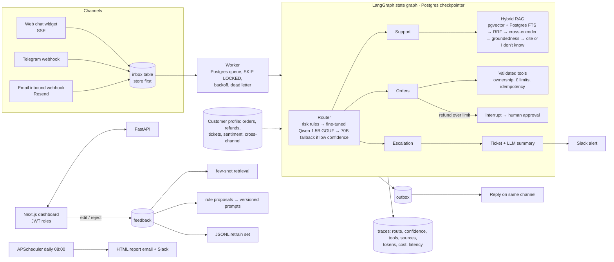

# Proposal: architecture, stack, hosting and one-day plan

Product: **Keel**, an AI operations desk for UK online shops. Demo tenant: **Hearth & Field**, a homeware retailer. Prices are in £, shipping is by Royal Mail/DPD/Evri, returns follow the Consumer Rights Act 2015 and data handling follows UK GDPR.

Repo: new and clean, `github.com/bano1397/keel-ai-ops`. The current `cadral-ops-agent` prototype stays local as a reference. Its offline rule engine, eval cases and tests carry over.

## Architecture

## Stack

| Layer | Choice | Why |
|---|---|---|
| API | FastAPI, Pydantic 2, SQLAlchemy 2 async, Alembic | Reuses AUTOPILOT-AI patterns |
| Agents | LangGraph with Postgres checkpointer; interrupts for approvals | Reuses AUTOPILOT supervisor + approval flow |
| LLM | Groq (Llama 3.3 70B answers, 3.1 8B cheap steps) → Gemini Flash fallback → offline rules. One provider interface | Free; 3-level fallback means a reply is never lost |
| Router model | Qwen2.5-1.5B-Instruct QLoRA (Unsloth, Colab T4) → GGUF Q4 → llama.cpp on CPU in the backend container | The fine-tune runs in the product, not on the side |
| RAG | pgvector + Postgres full-text (`ts_rank_cd`), RRF, fastembed `bge-small-en-v1.5`, fastembed cross-encoder `ms-marco-MiniLM-L-6-v2` | One database; runs on CPU; no paid rerank API |
| Queue / jobs | Postgres queue (`FOR UPDATE SKIP LOCKED`) + APScheduler | No Redis needed; one less free service to fail |
| Retries | `tenacity` for API calls; queue backoff; dead letter with retry button; idempotency keys | VoiceDesk 429 logic, lendloop idempotency |
| Webhooks | HMAC-signed with timestamp replay window | Ported from lendloop `signing.ts` |
| Frontend | Next.js 15 App Router, TypeScript, Tailwind, shadcn/ui, recharts | AutomationHub's newer Next version; AUTOPILOT chart/approval components |
| Tests | pytest (LLM mocked), Playwright for main flows, ruff, mypy, GitHub Actions with an eval subset | |
| Observability | `traces` table; Langfuse Hobby optional (50k units/month free) | |

**n8n:** the daily report, Slack alerts and email intake run in code. This is more reliable for a live demo with no extra always-on service. I also ship the same three flows as importable n8n workflow JSON in `automation/n8n/`, built from your AutomationHub templates and HMAC-signed. The README explains the trade-off, which shows the automation skill without risking the demo.

## Free-tier hosting (checked on official pages today)

| Need | Pick | Verified limits | Risk |
|---|---|---|---|
| Backend + worker + llama.cpp router (needs ~2–3 GB RAM) | **Oracle Cloud Always Free** Ampere A1 VM, docker-compose | Up to 2 OCPU / 12 GB RAM, always on, no cold start | Probably needs a card at sign-up; "out of capacity" errors are possible; idle VMs can be reclaimed after 7 days |
| Fallback backend | Render free | Its docs page couldn't be fetched, so limits are unverified | Sleeps when idle and has 512 MB RAM, too small for the GGUF router (it would use the 70B API instead) |
| Postgres + pgvector | **Neon Free** | 1 GB storage, 100 CU-hours/month, pgvector on all plans, no card | Suspends after 5 min idle; wakes in about a second |
| Frontend | **Vercel Hobby** | 1M function invocations, 100 GB transfer, no card | Hobby is for non-commercial use (fine for a test task) |
| Email in + out | **Resend Free** | 100/day, 3,000/month, inbound via webhook | Needs a domain you control for sending from your own address |
| Slack | Incoming webhook | 1 msg/s per channel | none |
| Fine-tune | **Google Colab T4** | Max 12 h per session; free GPU access is limited and not guaranteed | If no GPU is available, Kaggle is the backup (its limits couldn't be checked) |
| Not usable | HF Docker Spaces now need PRO; Koyeb free can't run a worker and sleeps after 1 h | | |

Groq and Gemini no longer publish free-tier numbers on their public pages. Check them in each console's limits page after you sign up.

## Plan for today (≈12 hours, Thu 27 Nov)

| Time | Block | Output |
|---|---|---|
| 0:00–0:45 | Fine-tune data + Colab notebook first | You start training (~20 min on a T4); it runs in the background while we build |
| 0:00–2:00 | Foundations, with subagents in parallel: (a) 25+ doc corpus + 150 products + static help site, (b) 100-case eval set, (c) Next.js scaffold | Repo skeleton, Docker, schema, seed, ingestion |
| 2:00–3:30 | RAG + tools | Hybrid search, rerank, citations, I-don't-know, groundedness; safe order tools; tests |
| 3:30–5:30 | LangGraph agents + streaming API + traces + auth | Router, 3 agents, memory, approval interrupt, SSE, JWT roles |
| 5:30–7:30 | Dashboard | Inbox, trace timeline, approvals, escalations, customers, analytics, KB, feedback/prompts, evals, settings |
| 7:30–9:00 | Automation + evals + fine-tune results | Telegram, email, queue/dead letter, daily report, Slack, `make eval`, CI, GGUF router integrated, before/after feedback numbers |
| 9:00–10:30 | Deploy | Oracle VM + Neon + Vercel; test every flow on the live URL |
| 10:30–12:00 | Docs + video + submission | README, write-up, REQUIREMENTS all ✅, demo script, recording + edit, message to Ammad Razzaq (you send it) |

**Biggest risks today, and my fallback for each**
1. **Oracle capacity or card.** If you can't get a VM within 15 minutes, fall back to Render (unverified). The router then uses Groq 8B, and the fine-tuned model is shown in the benchmark only. I'd say so honestly in the write-up.
2. **No Colab GPU.** Try Kaggle. If neither works, train on CPU with the 0.5B model as a last resort and say so.
3. **The 10-page dashboard is the largest time sink.** All 10 pages stay, but the secondary ones (Settings, Customers, KB) get a simple layout first.
4. **Video.** We record real screen captures in the last block. A polished Remotion edit with video-shotcraft may push past today; if so, the plain recording ships first.
